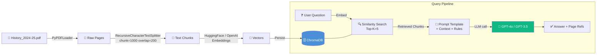

# 📖 Orient BlackSwan History Bot — RAG QA System

> **Project 4 · Gen-AI Mid-Semester Project**
> A Retrieval-Augmented Generation chatbot that answers questions exclusively
> from the *Orient BlackSwan History Catalogue 2024-25* PDF.

---

## 🏗️ Architecture



### RAG Flow (Step-by-Step)

| Step | Component | Detail |
|------|-----------|--------|
| 1 | **PDF Loading** | `PyPDFLoader` extracts text per page with metadata (page number) |
| 2 | **Chunking** | `RecursiveCharacterTextSplitter` (1 000 chars, 200 overlap) |
| 3 | **Embedding** | HuggingFace `all-MiniLM-L6-v2` (384-d, free) or OpenAI |
| 4 | **Indexing** | Chunks + embeddings stored in ChromaDB (persistent on disk) |
| 5 | **Retrieval** | Top-5 most similar chunks fetched for each query |
| 6 | **Generation** | GPT-4o synthesises an answer from the context only |
| 7 | **Citation** | Prompt forces `[Page N \| Section]` references |
| 8 | **Fallback** | If no relevant context → `"Not found"` |

---

## 🚀 Quick Start

### Prerequisites

| Requirement | Version |
|-------------|---------|
| Python | 3.10 + |
| pip | latest |
| OpenAI API key | Required |

### 1. Clone & enter the project

```bash
cd Gen_midsem_project
```

### 2. Create a virtual environment

```bash
python -m venv .venv
source .venv/bin/activate   # macOS / Linux
# .venv\Scripts\activate    # Windows
```

### 3. Install dependencies

```bash
pip install -r requirements.txt
```

### 4. Configure environment

```bash
cp .env.example .env
# Edit .env and paste your OPENAI_API_KEY
```

### 5. Place the PDF

Copy **`History_2024-25.pdf`** into the **`data/`** folder.

### 6. Run the bot

```bash
# Interactive Q&A mode (default)
python rag_bot.py

# Batch evaluation of the 5 project questions
python rag_bot.py --batch

# Force-rebuild the vector store
python rag_bot.py --rebuild
```

On the first run the vector store is built automatically and persisted to `./chroma_db/`.

---

## ❓ 5 Project Questions — Expected Answers

| # | Question | Expected Answer | Reference | Category |
|---|----------|----------------|-----------|----------|
| Q1 | On what date were the prices in this catalogue last updated? | **20-01-2025** | Catalogue cover / introductory page | ✅ Found |
| Q2 | In which year was the publisher (Orient BlackSwan) incorporated? | **1948** | About the publisher / inside cover | ✅ Found |
| Q3 | What is the price of a Physics textbook? | **Not found** — This is a History catalogue; it does not list Physics textbooks. | N/A | ❌ Not found |
| Q4 | Who is the current Minister of Education? | **Not found** — The catalogue does not contain information about government officials. | N/A | ❌ Not found |
| Q5 | Which is the "best" history book for a beginner? | **Not found / Subjective** — The catalogue does not rank books as "best". The bot may list introductory titles if present. | N/A | ⚠️ Subjective |

### Ground Truth Rationale

- **Q1 & Q2** test the bot's ability to *retrieve factual information* with exact references.
- **Q3 & Q4** test the bot's *"Not found" fallback* — Q3 is out-of-domain (wrong subject), Q4 is external knowledge.
- **Q5** tests handling of *subjective/opinion-based* questions with no single correct answer in the source.

---

## 📂 Project Structure

```
Gen_midsem_project/
├── rag_bot.py              # Main application (all-in-one)
├── requirements.txt        # Python dependencies
├── .env.example            # Environment variable template
├── .env                    # Your actual secrets (git-ignored)
├── data/
│   └── History_2024-25.pdf # Source document (place here)
├── chroma_db/              # Persistent vector store (auto-generated)
├── README.md               # This file
└── screenshots/            # Execution screenshots for LMS
    ├── 01_setup.png
    ├── 02_vectorstore_build.png
    ├── 03_batch_results.png
    ├── 04_interactive_qa.png
    └── 05_not_found_example.png
```

---

## 🖼️ Execution Screenshots (for LMS Submission)

> **Instructions:** After running the bot, take screenshots and save them
> in the `screenshots/` folder. Replace the placeholder paths below with
> your actual screenshots.

### 1. Setup & Installation
<!--  -->
*Screenshot: terminal showing `pip install -r requirements.txt` completing successfully.*

### 2. Vector Store Build
<!--  -->
*Screenshot: terminal showing PDF loading, chunk count, and Chroma persistence messages.*

### 3. Batch Evaluation Results
<!--  -->
*Screenshot: the comparison table from `python rag_bot.py --batch`.*

### 4. Interactive Q&A Session
<!--  -->
*Screenshot: a few interactive questions and the bot's answers with page references.*

### 5. "Not Found" Example
<!--  -->
*Screenshot: asking Q3 or Q4 and receiving the "Not found" response.*

---

## ⚙️ Configuration Reference

All settings can be overridden in `.env`:

| Variable | Default | Description |
|----------|---------|-------------|
| `OPENAI_API_KEY` | — | **Required.** Your OpenAI API key |
| `PDF_PATH` | `data/History_2024-25.pdf` | Path to the source PDF |
| `CHROMA_DIR` | `./chroma_db` | ChromaDB persistence directory |
| `EMBEDDING_TYPE` | `huggingface` | `huggingface` (free) or `openai` |
| `HF_MODEL_NAME` | `sentence-transformers/all-MiniLM-L6-v2` | HuggingFace model |
| `LLM_MODEL` | `gpt-4o` | `gpt-4o` or `gpt-3.5-turbo` |
| `CHUNK_SIZE` | `1000` | Characters per chunk |
| `CHUNK_OVERLAP` | `200` | Overlap between chunks |
| `TOP_K` | `5` | Number of chunks retrieved |

---

## 🔧 Tech Stack

| Layer | Technology |
|-------|-----------|
| Language | Python 3.10+ |
| Framework | LangChain 0.3.x |
| Vector DB | ChromaDB 0.5.x |
| Embeddings | HuggingFace `all-MiniLM-L6-v2` / OpenAI |
| LLM | OpenAI GPT-4o / GPT-3.5-turbo |
| PDF Parsing | pypdf via `PyPDFLoader` |
| Terminal UI | Rich |

---

## 📜 License

Academic project — Orient BlackSwan History Catalogue © Orient BlackSwan Pvt Ltd.
Code provided for educational purposes only.
# Genai_midsem
